# SmartFix Database Design

PostgreSQL 15+ with PostGIS on Supabase. Script: `smartfix_schema.sql` (28 tables, 4 helper functions, 5 views, 2 triggers).

## Entity-relationship diagram

```mermaid
erDiagram
    users ||--o{ reports : submits
    users ||--o{ push_subscriptions : has
    users ||--o{ crew_members : "belongs to"
    crews ||--o{ crew_members : has
    crews ||--o{ crew_specialties : covers
    crews ||--o{ crew_service_areas : serves
    service_areas ||--o{ crew_service_areas : in
    service_areas ||--o{ issues : contains
    problem_types ||--o{ crew_specialties : "matched by"
    problem_types ||--o{ issues : classifies
    problem_types ||--o{ reports : "chosen category"

    issues ||--|{ reports : "groups (merge)"
    photos ||--|| reports : "evidence"
    reports ||--o{ validations : "model runs"
    reports ||--o{ duplicate_checks : "compared"
    issues ||--o{ duplicate_checks : "candidate"
    reports ||--o| review_queue : "low confidence"

    issues ||--o{ priority_history : scored
    issues ||--o{ work_orders : repaired_by
    crews ||--o{ work_orders : assigned
    work_orders ||--o{ work_order_assignments : "reassign log"
    work_orders ||--o| repair_verifications : "before/after check"
    work_orders ||--o| resident_confirmations : "confirm/dispute"
    work_orders ||--o| repair_metrics : measured

    issues ||--o{ events : "timeline"
    events ||--o{ processed_events : "idempotency"
    events ||--o{ dead_letter_events : "failed 3x"
    issues ||--o{ issue_status_history : "status log"
    status_transitions }o--o{ issue_status_history : "authorises"
    users ||--o{ notifications : receives
    events ||--o{ notifications : "triggers"
```



## Key design decisions

| Decision | Why |
|---|---|
| **Issue vs. report are separate tables** | Many residents can report one pothole (FR-3). Reports keep their own photo, pin and reporter; the issue carries status, severity and priority. |
| **Every submission starts with its own `reported` issue** | Keeps the proposal's status flow intact. If Validation finds a duplicate, the report is re-pointed to the existing issue and the provisional one becomes `merged`. |
| **Two extra statuses: `rejected`, `merged`** | The proposal lists nine statuses, but a rejected report (FR-4) and a merged duplicate (FR-3) need a terminal state. Easy to drop if the team prefers another representation. |
| **Aging computed at read time** (`v_issue_queue`) | Only `severity + capped duplicate bonus` is stored. No background job has to rewrite every row to keep aging fresh, and the cap (FR-5) lives in `priority_config`. |
| **Status ownership enforced by a trigger** | `status_transitions` lists which module may make each move. Each module runs `SET LOCAL app.module = '...'` in its transaction; anything else is rejected (NFR-4). Every change is logged to `issue_status_history`. |
| **`processed_events (consumer, event_id)`** | `INSERT ... ON CONFLICT DO NOTHING`; zero rows inserted means skip. Handles RabbitMQ duplicate delivery per consumer (NFR-4). |
| **One active work order per issue** | Partial unique index. A dispute (FR-9) inserts a new work order after the old one is `completed`. |
| **Tunables in `priority_config` and `severity_sla`** | Weights, cap, 50 m radius, 7-day auto-close and deadlines can change without redeploying. |
| **PostGIS `geography` + GiST indexes** | `ST_DWithin` on metres gives the 50 m duplicate lookup and the map queries directly. |

## Requirement coverage

| Requirement | Where |
|---|---|
| FR-1 submit report | `reports`, `photos`, `problem_types` |
| FR-2 classify + severity | `validations` |
| FR-3 duplicates within 50 m | `find_nearby_open_issues()`, `duplicate_checks`, `issues.merged_into_id` |
| FR-4 operator review | `review_queue` |
| FR-5 priority score | `priority_config`, `compute_priority_base()`, `v_issue_queue`, `priority_history` |
| FR-6 crew match + deadline | `pick_crew()`, `work_order_deadline()`, `severity_sla` |
| FR-7 crew updates + after photo | `work_orders`, `photos(kind='after')` |
| FR-8 before/after check | `repair_verifications` |
| FR-9 / FR-10 dispute, 7-day close | `resident_confirmations` (`auto_close_at`) |
| FR-11 escalation | `work_orders.escalated_at`, `issues.is_escalated`, `idx_work_orders_deadline` |
| FR-12 push notifications | `notifications`, `push_subscriptions` |
| FR-13 live map, reassign | `v_operator_map`, `work_order_assignments` |
| FR-14 event history | `events`, `v_issue_timeline` |
| FR-15 repair statistics | `repair_metrics`, `v_repair_stats` |
| NFR-3 dead-letter | `dead_letter_events` |
| NFR-4 idempotency + ownership | `processed_events`, `status_transitions` + trigger |
| NFR-6 role-based access | `users.role`, `crew_members` (enforced in FastAPI; optional Supabase RLS) |
| SDG 9.1 equity stretch goal | `v_area_hotspots` |

## Usage notes for the team

- **Transaction pattern for every consumer:**
  ```sql
  BEGIN;
  SET LOCAL app.module = 'priority';
  SET LOCAL app.event_id = '<event uuid>';
  INSERT INTO processed_events (consumer, event_id) VALUES ('priority', '<event uuid>')
      ON CONFLICT DO NOTHING;           -- 0 rows => already handled, ROLLBACK and ack
  -- ... do the work, UPDATE issues SET status = ... ...
  COMMIT;
  ```
- **Escalated issues** keep their normal status path afterwards (`escalated` to `assigned`, `in_progress` or `completed`) and `is_escalated` stays true until closed, so they stay at the top of the queue.
- **Supabase:** the script uses its own `users` table. If you prefer Supabase Auth, replace `users.user_id` references with `auth.users(id)` and keep `users` as a profile table.
- **Placeholders to confirm:** SLA hours, priority weights (10 per severity point, 2 per duplicate capped at 10, 1.5 per day of aging) and the 7-day window are starting values, not requirements.
- **Tested:** the script was loaded into PostgreSQL 16 + PostGIS 3.4 and run through a full lifecycle (report, duplicate merge, prioritisation, assignment, completion, close). An out-of-turn transition was correctly rejected.
